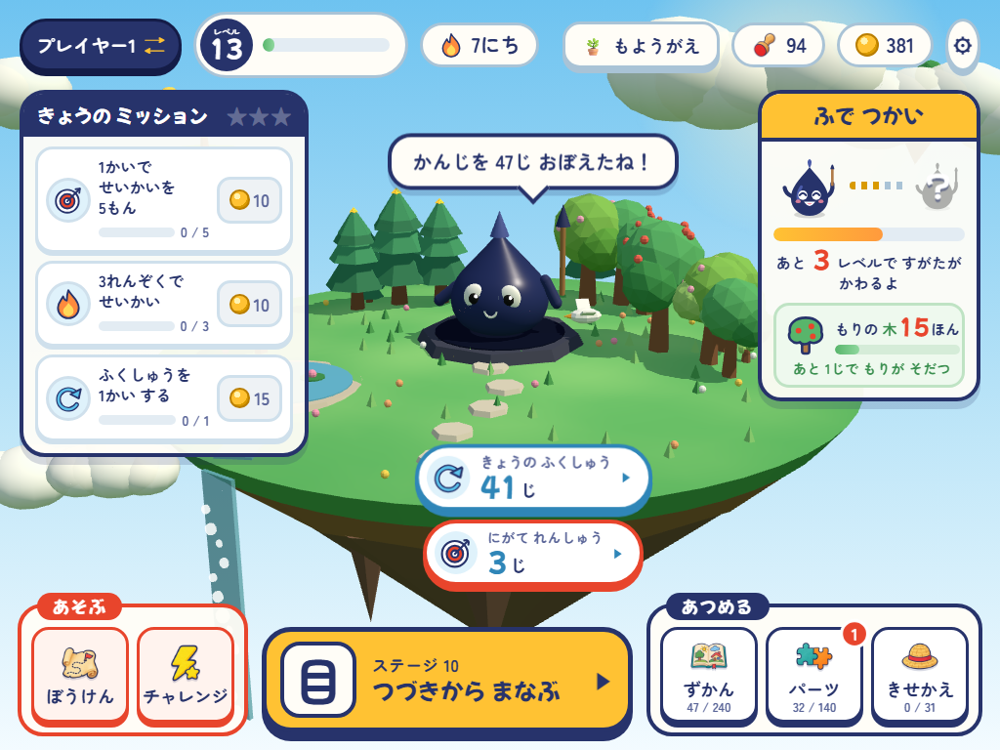
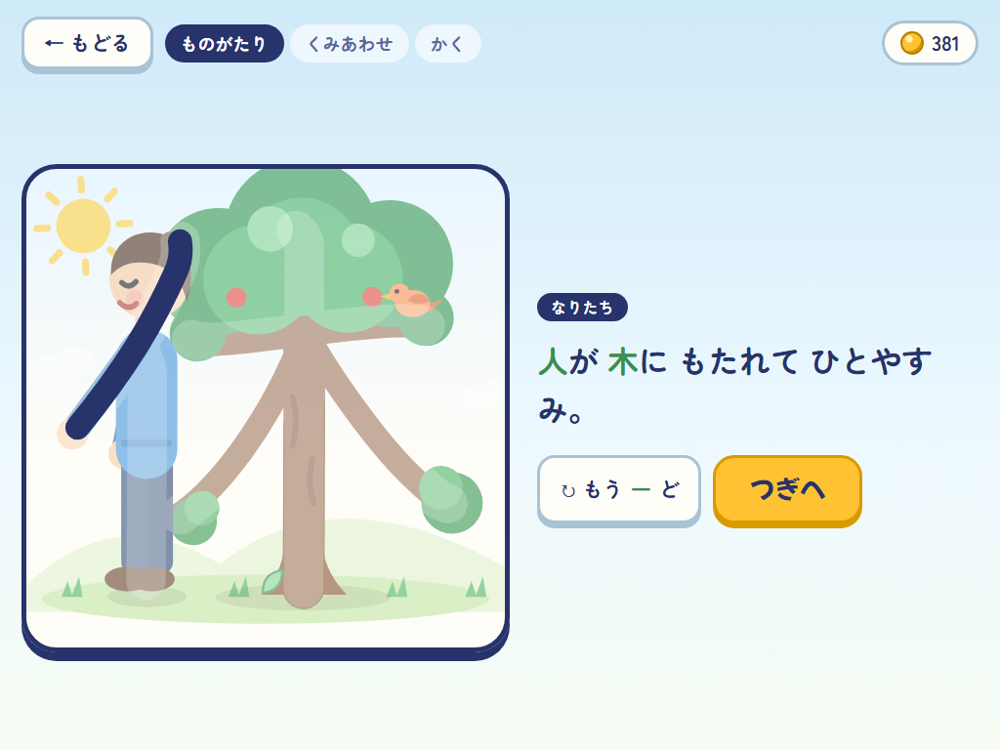
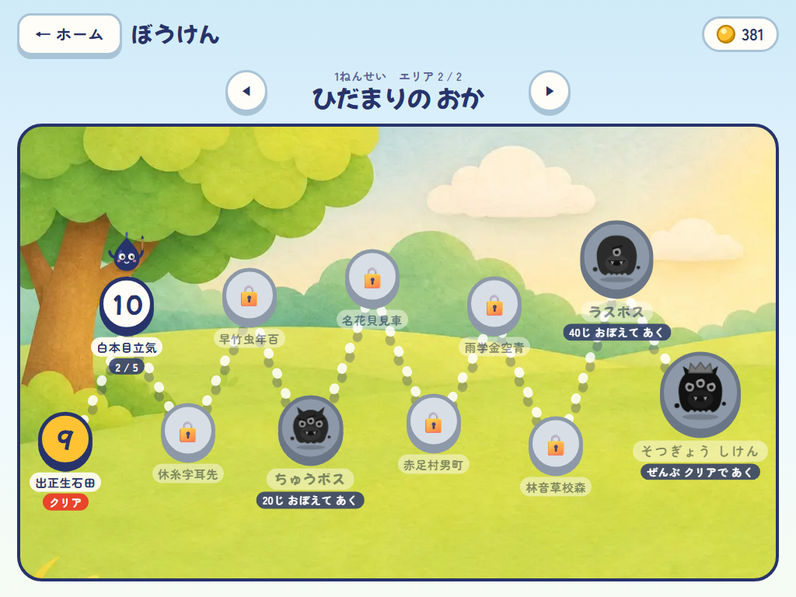
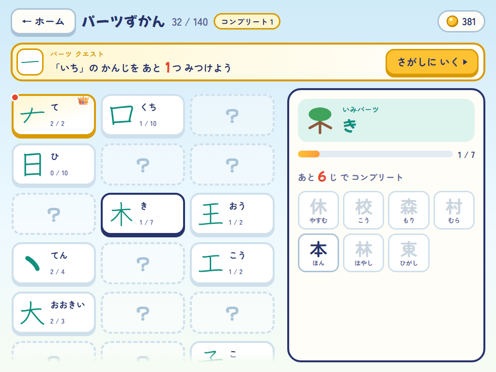
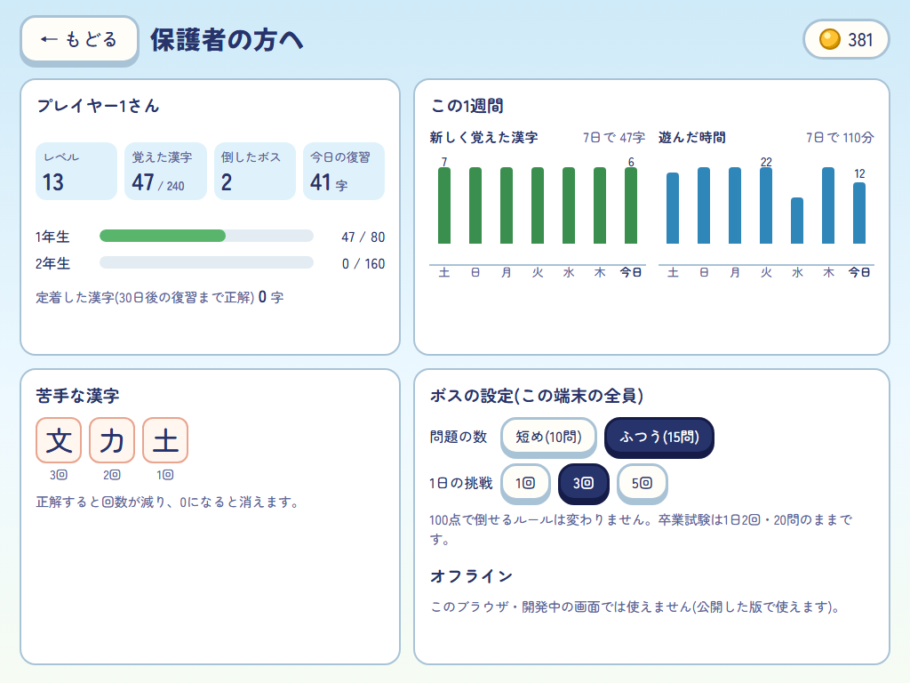

# 漢字クエスト

 -3f9b5a)

漢字を「文字」ではなく「形と部位の組み合わせ」で覚えるための学習アプリの試作です。
読み書きが苦手でも、形を見て考えるのが得意な子が、絵と物語から漢字の意味を想像できることを目指しています。

- 小学1年(80字)と2年(160字)の240字を収録
- 横向きタブレット(iPad など)が基準。一度ひらけば電波がなくても あそべる
- ログインなし。記録は端末の中(localStorage)にだけ保存

**あそぶ: https://kabatin.github.io/kanji-quest/** (iPad などの横向きタブレット向け)



| なりたちの物語 | ぼうけん |
|---|---|
|  |  |
| 絵が動いて、さいごに そのまま字になる(240字 ぜんぶ) | 5字で1ステージ。エリアの まんなかに 中ボス、さいごに ラスボス |

| パーツずかん | 保護者の方へ |
|---|---|
|  |  |
| 同じ部位を持つ なかまの字を集める | 覚えた字・1週間のようす・苦手な字が見える |

## できること

| | |
|---|---|
| まなぶ | 物語(なりたち。絵が動いて、さいごに そのまま字になる)→ くみあわせ(部位をえらんで合体)→ かく(書き順つき) |
| ぼうけん | 5字ずつのステージを進み、エリアの 中ボス と ラスボス を 100点で たおす。学年の最後は そつぎょうしけん |
| きょうの ふくしゅう | 覚えた字を 1・3・7・14・30日後に もう一度出す |
| にがて れんしゅう | ボスや ふくしゅう で まちがえた字を、見て書く → 見ないで書く の順に れんしゅう する(`src/lib/weak.ts`) |
| あつめる | 漢字ずかん、パーツずかん(パーツ クエスト)、きせかえ |
| そだてる | すみまる がレベルで 8つの姿に変わり、しまの森が育つ |
| おうちの方 | 子どもごとの記録、ボスの問題数と回数の設定。1台で6人まで使える |

変更の記録は [CHANGELOG.md](CHANGELOG.md) にあります。
上の画面写真(`docs/screenshots/`)は `node scripts/screenshots.mjs` で撮りなおせます。

## 使い方

```
npm install
npm run dev        # 開発サーバー(このPCだけ)
npm run dev:lan    # 開発サーバー(同じWi-FiのiPadなどから開ける。ポート5190)
npm run test       # ユニット・コンポーネントテスト
npm run coverage   # カバレッジつき
npm run e2e        # Playwright(初回は npx playwright install chromium)
npm run build      # 本番ビルド(dist/)
```

## あそびの しくみ

| もの | 中身 |
|---|---|
| ホーム | 空にうかぶ しま(Three.js)。漢字を1字おぼえるたびに森が1段階 育つ。メニューは「あそぶ(ぼうけん・チャレンジ)」と「あつめる(ずかん・パーツ・きせかえ)」に分かれる |
| ぼうけん | 学年ごとに、5字で1ステージ・8ステージで1エリア。前のステージの5字を覚えると次が開く。エリアの まんなか(4ステージ目のあと)に 中ボス、さいごに ラスボス がいて、中ボスの先は 中ボスを たおすと開く(`src/lib/stages.ts`) |
| ボス | 中ボスは そこまでに出た20字、ラスボスは エリアの40字から、同じ字が重ならないように15問: えらぶ5問(つくり・ぜんぶの部位・なりたちの話・絵)+ 見本を見て書く5問 + 見本なしで書く5問。全部まちがえずに できて 100点になると たおせる。書き順のまちがい・長すぎる線(書きなぐり)も まちがいに数える。苦手な字(まちがえた回数が のこっている字)から先に出す。ちょうせん は1日3回(れんしゅう は何回でも) |
| そつぎょうしけん | 学年の漢字を全部学び、エリアの ボスを全部たおすと ちょうせん できる。学年の漢字から 20問。1日2回 |
| 音 | 効果音(`src/lib/sound.ts`)と音楽(`src/lib/music.ts`)は、音のファイルを使わず アプリの中で作って鳴らす。曲は 楽譜の文字列で書いてあり、ホーム・ぼうけん・ボス の3曲 |
| すみまる | レベルで 8つの すがた に変わる(`src/lib/level.ts` の `MASCOT_FORMS`) |
| きせかえ | ぼうし・しまの かざり・そら・カード。コインで買い、高いものは必要なレベルもある(`src/lib/shop.ts`) |
| もようがえ | 持っている かざり を、ホームの しま(3D)の上で指で ひっぱって すきな場所に置く。つかんだ かざり は 45度ずつ まわしたり、しまって あとで出したり できる。置ける場所の きまり は `src/features/home/scene/layout.ts` の `settleDeco`。3D が使えない端末では できない |

経験値・コイン・ねだんは、6年生まで(1026字)続けたときの合計から決めています。考え方は
`src/lib/level.ts`、`src/lib/rewards.ts`、`src/lib/shop.ts` の先頭のコメントにあります。

ホームの 3D は `src/features/home/scene/` にあります。3D が使えない端末では、絵(SVG)の森が代わりに出ます。

## ふくしゅう・パーツ クエスト・保護者向け画面

| もの | 中身 |
|---|---|
| きょうの ふくしゅう | 覚えた字を 1日後・3日後・7日後・14日後・30日後 に もう一度出す(`src/lib/review.ts`)。1回で できたら次の間隔へ、まちがえたら次の日から やりなおし。間隔が のびるほど、えらぶ → 見て書く → 見ないで書く と むずかしくなる。ホームの まんなかに入り口が出る |
| パーツ クエスト | パーツずかんの上に「○○の かんじを あと N つ」を出し、なかまを全部 覚えると コンプリートで ごほうび(`src/lib/partQuest.ts`) |
| 保護者の方へ | せってい → 「おうちの かたへ」。かけ算1問で入る。子どもごとの 覚えた字・この1週間(覚えた字と遊んだ時間)・苦手な字・復習のようす。ボスの問題数(10問/15問)と1日の回数(1/3/5回)を変えられる(この端末の全員にかかる) |

遊んだ時間は、画面が見えている間 1分ごとに数えます。

## オフライン(PWA)

公開した版(`npm run build`)では、サービスワーカー(`public/sw.js`)が入り、一度ひらけば電波がなくても あそべます。

- アプリ本体(画面・絵・データ)は、はじめて ひらいたときに保存します
- 音声(約18MB)は、そのあと うらで少しずつ保存します。保護者向け画面で「音声 603 / 603」のように進みぐあいが見えます
- 保存するファイルの一覧(`dist/precache.json`)は、ビルドのときに `scripts/precache-plugin.ts` が作ります
- iPad では Safari の共有メニュー →「ホーム画面に追加」で、アプリのように ひらけます(アイコンは `public/icons/`、作りなおすときは `node scripts/build-icons.mjs`)
- 文字(Google Fonts)は、2回目に ひらいたときから保存されます
- 確認: `npm run e2e:pwa`(ビルドして、電波を切っても ひらけるか・音声が鳴るかを試す)

## 公開(GitHub Pages)

`master` に push すると、GitHub Actions(`.github/workflows/pages.yml`)がテストとビルドをして、
https://kabatin.github.io/kanji-quest/ に公開します。だれでも ひらけます。

## データの作り方

漢字・部位・説明・音声は、手で書いた一覧からスクリプトで作ります。`src/data/generated/` と
`src/data/narration.json`、`src/assets/kanjivg/strokes.json` は生成物なので、直接は編集しません。

| 手で書くもの | 中身 |
|---|---|
| `scripts/kanji-list.mjs` | 収録する漢字(学年別) |
| `scripts/kanji-source.mjs` | 漢字の読みと絵、くみあわせの分け方、部位の名前と絵、手書きの成り立ち説明 |

```
node scripts/fetch-kanjivg.mjs <フォルダ>   # KanjiVG の SVG を取得
node scripts/build-data.mjs <フォルダ>      # 漢字・部位・説明のデータを生成
npm run voice                               # 説明などの音声を生成(下記)
```

- `COMPOUNDS` に書いた漢字は、学習の中に「くみあわせ」(固定の部位+4択)が入ります。
- くみあわせは「何画目がどの部位か」を KanjiVG の画番号で指定します。

### 成り立ちの物語

| ファイル | 中身 |
|---|---|
| `scripts/stories/*.json` | 漢字ごとの物語。`caption`(画面の文)、`speech`(音声の文)、`kind`(naritachi = 字源にもとづく / oboekata = 形からの覚え方)、`actors`(アニメーションに出る絵と動き)、`source`(参考にしたURL)、`note`(諸説などの補足) |
| `scripts/stories-markup/*.json` | 物語の文に `{漢字|よみ}` の印を付けたもの |

- 手づくりの場面(下記)がない字では、物語のアニメーションは、`actors` の絵を「その部位がある場所」に置き、`motion`(もたれる・落ちる・入る など)で動かしてから、筆画に変えます。
- `{漢字|よみ}` の印は「その漢字を覚えていれば漢字、まだなら読みを表示する」ためのものです。画面の文言でも同じ書き方が使えます(`src/components/KText.tsx`)。
- 物語がない・形が合わない字は、`NARRATION_OVERRIDES` か「AとBで、C」の自動文で代用し、生成時に一覧が出ます。
- 物語を直したら `build-data.mjs` を実行し、音声も作りなおします(`public/voice/explain-*.mp3` を消してから `npm run voice`)。

### 手づくりの場面

240字 ぜんぶに、絵が動いて さいごに そのまま字になる場面があります。1字1ファイルで(`src/features/story/scenes/k<文字コードの16進>.tsx`)、
その字の物語を ひらいたときに読みこみます。部品と時間の関数は `src/features/story/sceneKit.ts` と `sceneParts.tsx` にあります。

- 作り方の手引き: `docs/scene-guide.md`(人や物は 現実の正しい形で描く。主役を決めて、気持ちの変化と できごとの わけ を入れる)
- 1字を確かめる: `node scripts/scene-check.mjs <字>`(型・書き順・コマ送りを まとめて)。コマ送りの画像だけなら `node scripts/scene-sheet.mjs <字>`(`.scene-sheets/` に出る)
- 開発サーバーで `?scene=字` をひらくと その字のコマ送り、`?gallery` をひらくと ぜんぶの場面が動いて ならび、字ごとに「よい」「なおしたい」と メモ を付けられます(公開する版には入りません)

## 音声

読み・お題・成り立ちの説明は、[AivisSpeech](https://aivis-project.com/) で事前に作った音声(`public/voice/*.mp3`)を再生します。
音声がないクリップは、ブラウザの読み上げ機能で代わりに読みます。

```
npm run voice                    # まだない音声だけ作る(AivisSpeech を起動しておく。ffmpeg が必要)
npm run voice -- --force         # 全部作りなおす
npm run voice -- <スタイルID>    # 声を変える
```

今の音声は、モデルの利用規約を確認したうえで公開しています。声(スタイル)を変えるときは、そのモデルの利用規約を確認してください。

## 絵

マップの背景・ボスのどうくつ・メニューのアイコン(`src/assets/art/*.webp`)は、Codex の画像生成で作った絵です。
1枚目(`map-mori`)を画風の見本として渡し、同じ画風で残りを作っています。
元の PNG を ffmpeg で WebP にしています(背景は横 1536px、アイコンは 256px)。

## あそぶ人(アカウント)

1台の端末を何人かで使えるよう、「あそぶ人」を6人まで作れます(ホーム左上の名前から切りかえ)。
ログインはなく、進みぐあいは人ごとに端末の中に保存されます(`src/lib/profiles.ts`、`src/store/profiles.ts`)。
2人以上いるときは、ひらいたときに「だれが あそぶ？」を聞きます。

## ライセンス

漢字の画データは [KanjiVG](https://kanjivg.tagaini.net)(© Ulrich Apel, CC BY-SA 3.0)を加工して使っています。
詳細は `src/assets/kanjivg/LICENSE.md` を見てください。
